<p align="center">
  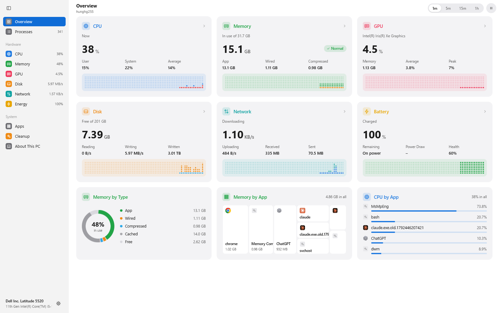
</p>

<h1 align="center">mymonitor</h1>

<p align="center">A small, smooth activity monitor for Windows, with a panel in the taskbar's corner.</p>

<p align="center">Built on <a href="https://github.com/hunghg255/myzig"><strong>myzig</strong></a>, laid out as Windows 11's own apps are.</p>

<p align="center">
  
  
  
  
  
</p>

<p align="center">
  <a href="#download">Download</a> ·
  <a href="#get-started">Get started</a> ·
  <a href="#pages">Pages</a> ·
  <a href="#what-it-reads">What it reads</a> ·
  <a href="#using-it">Using it</a> ·
  <a href="#credits">Credits</a>
</p>

mymonitor shows every process, the machine's CPU, memory, GPU, disk, network
and battery over the last minute to hour, what each app is using, and what can
be cleaned up. It works out of the box: no helper, no daemon, no admin rights.
Each part of the machine has its color (CPU blue, memory green, GPU rose, disk
orange, network teal, energy amber) on light gray cards, light or dark as
Windows is, set in Segoe UI. An icon in the taskbar's corner shows the same at
a glance: hover it for a line ("CPU 18% · Memory 16.6 GB / 31.7 GB"), click it
for a panel.

## Download

**Windows** (10 and 11): build it (below); `zig build -Doptimize=ReleaseFast`
leaves `zig-out\bin\mymonitor.exe`, one file with its icon inside.

**macOS and Linux** share the code (`zig build`), with the figures those
systems give (no battery, volumes, interfaces or Cleanup there yet); they
haven't been built since the redesign. `sh macos/package.sh` makes a macOS
disk image. The pages below are Windows'.

## Get started

mymonitor builds against myzig checked out next to it (`../myzig`, set in
`build.zig.zon`):

```sh
git clone https://github.com/hunghg255/myzig myzig
git clone https://github.com/justrach/nanomon mymonitor
cd mymonitor
zig build run
zig build test        # the model, the table, every page through ui.Tester, real samples
zig build shots && zig-out/bin/mymonitor-shots <dir> [--dark]   # every page, live, offscreen
```

The tests write a picture of every page to `/tmp/mymonitor-*.png`;
`mymonitor-shots` draws every page, Settings and the tray's panel with this
machine's own figures, without a window. `python tools/make-icon.py` draws
the icon again.

Working on myzig at the same time? In a `--recursive` clone of
[myzig](https://github.com/hunghg255/myzig), mymonitor lives under `apps/`.
Build it there against the myzig next to it, with your changes, using
`--fork`:

```sh
cd myzig/apps/mymonitor
zig build run --fork=../..
```

## Pages

<p align="center">
  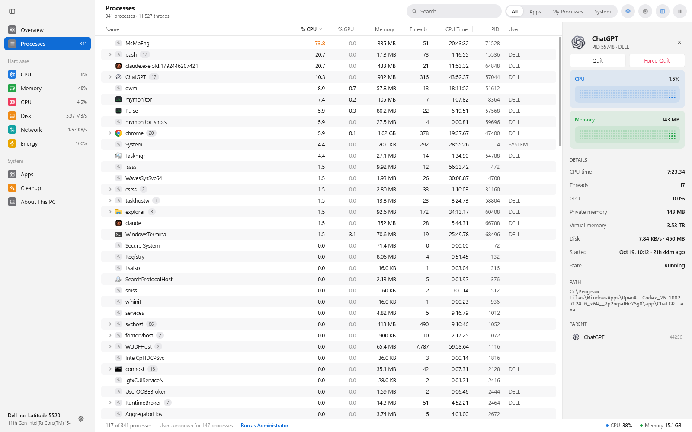
  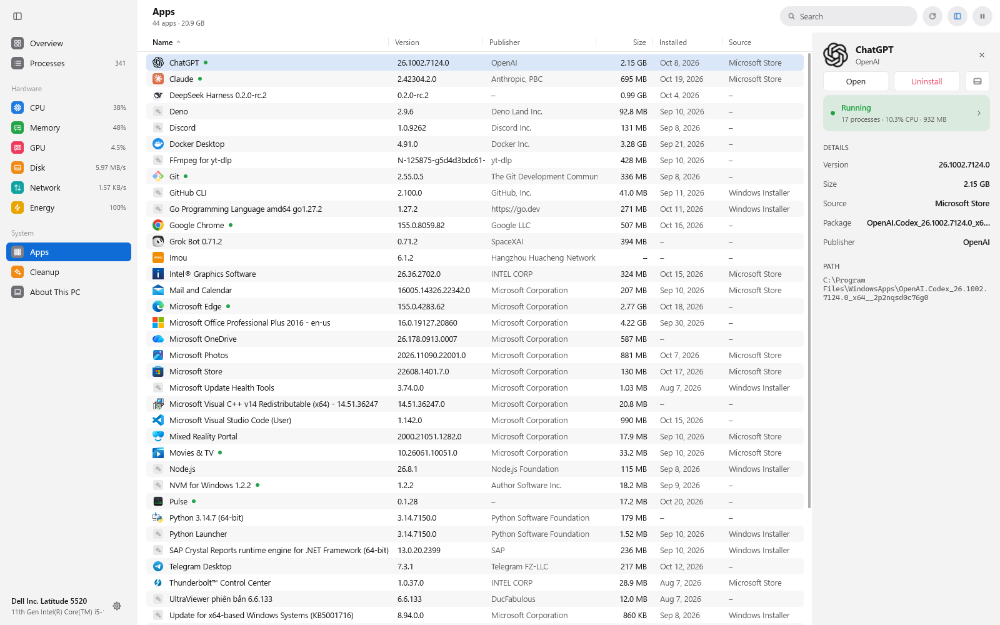
</p>
<p align="center">
  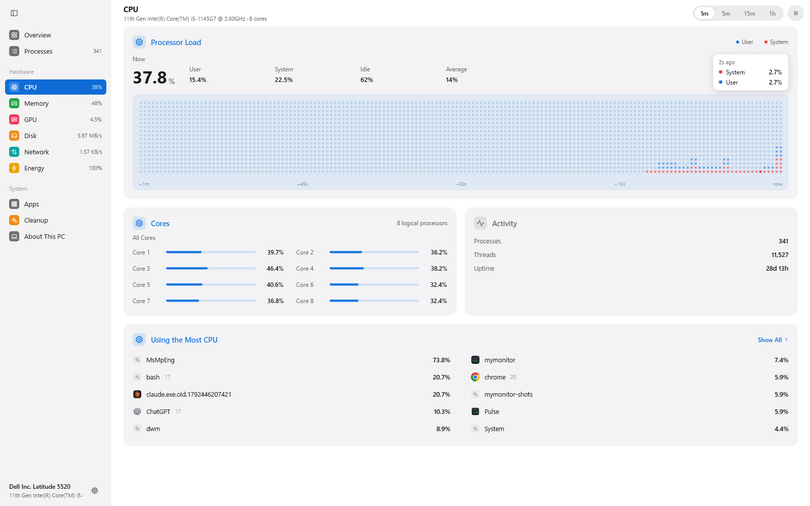
</p>
<p align="center">
  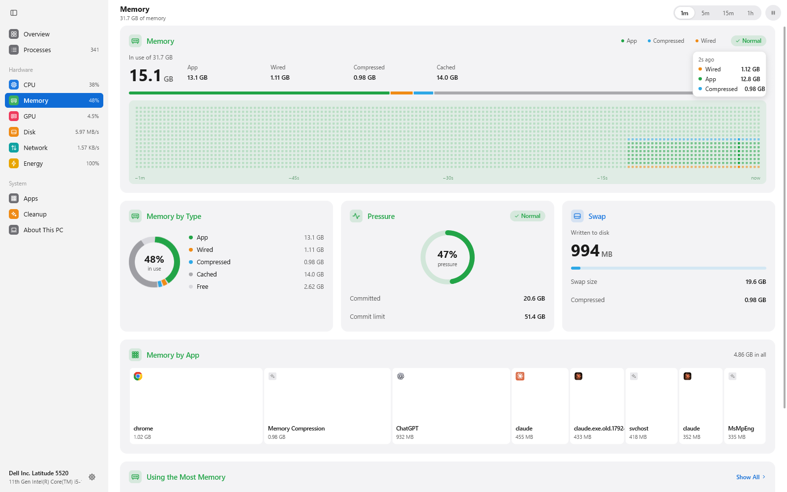
  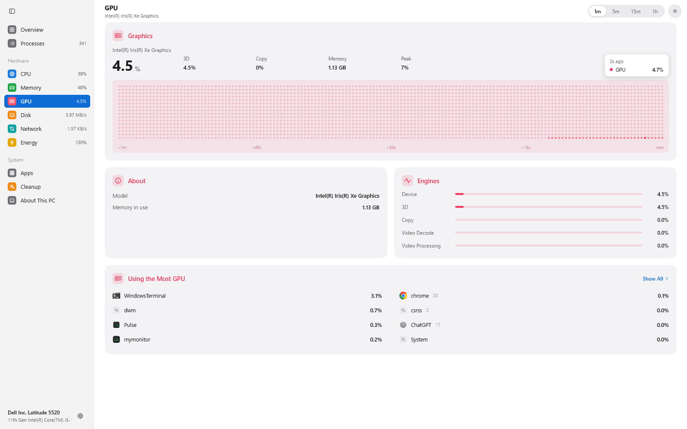
</p>
<p align="center">
  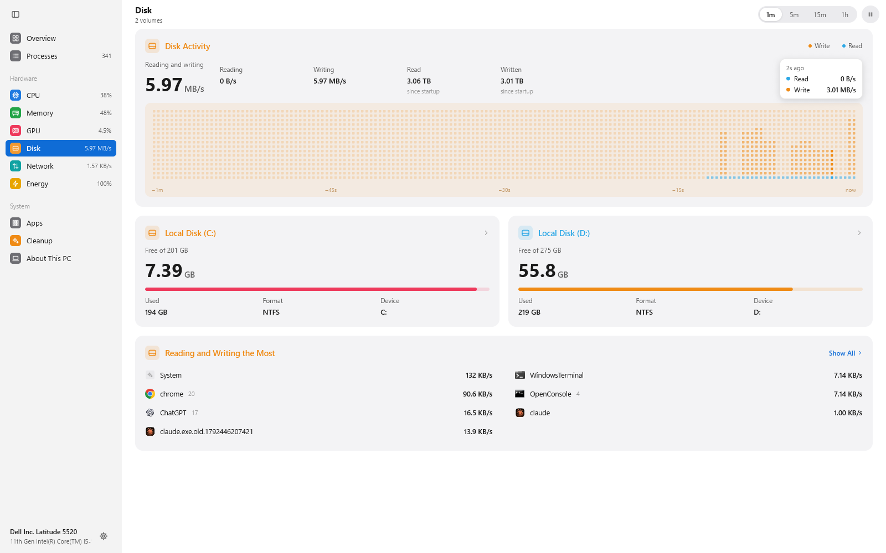
  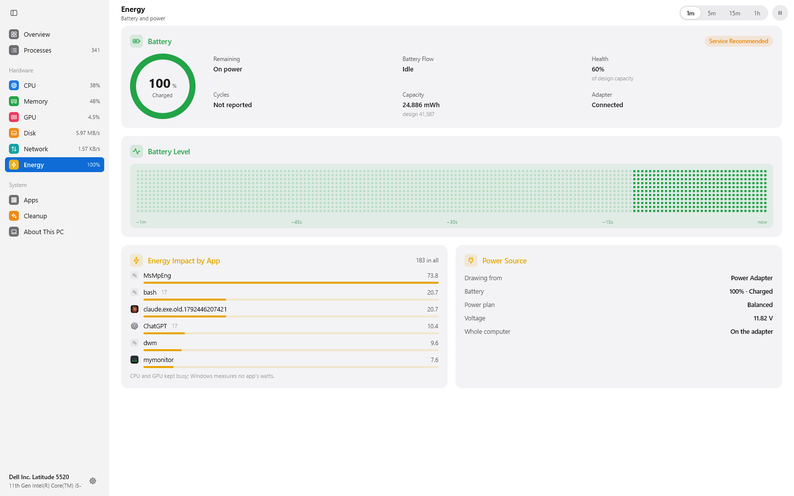
</p>
<p align="center">
  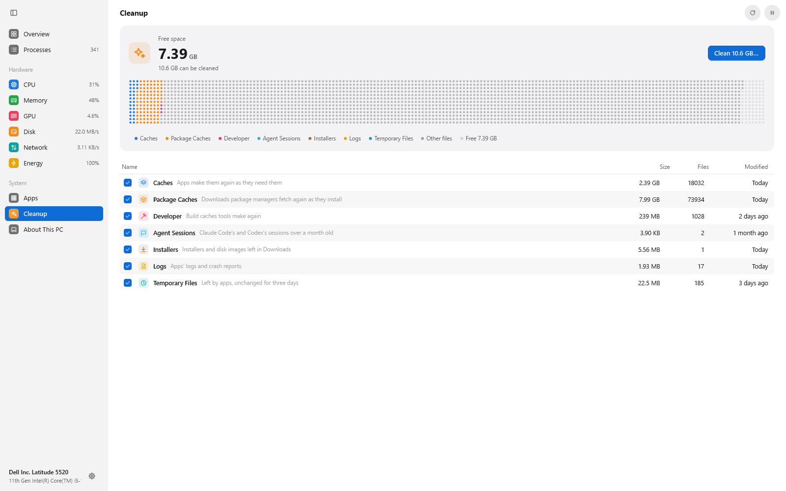
  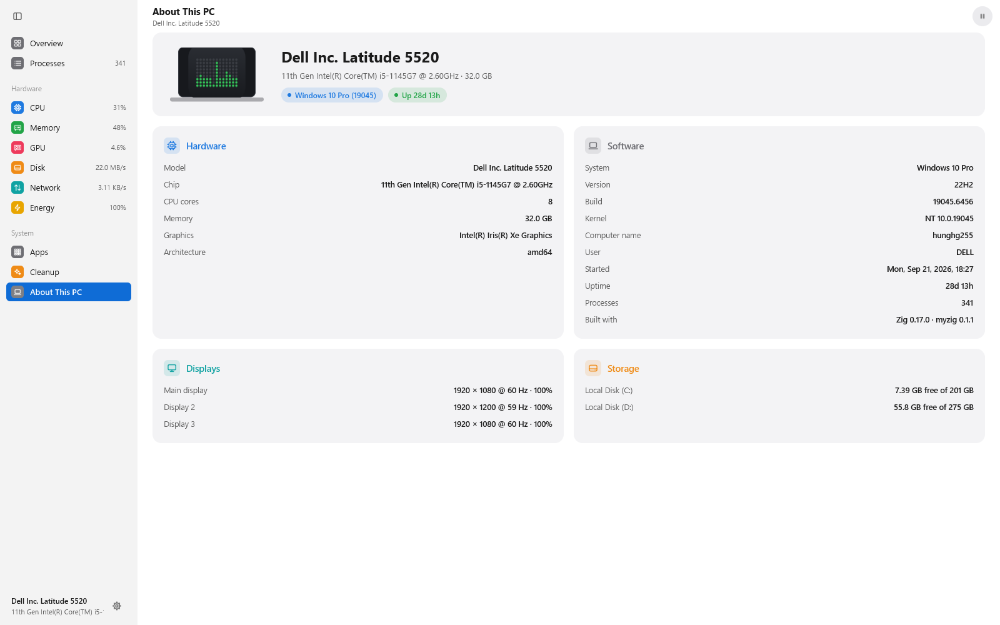
</p>
<p align="center">
  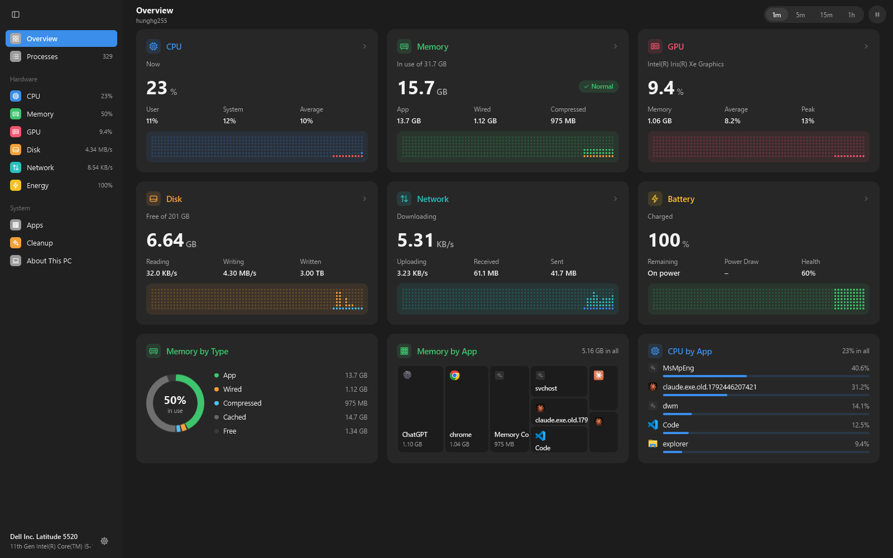
  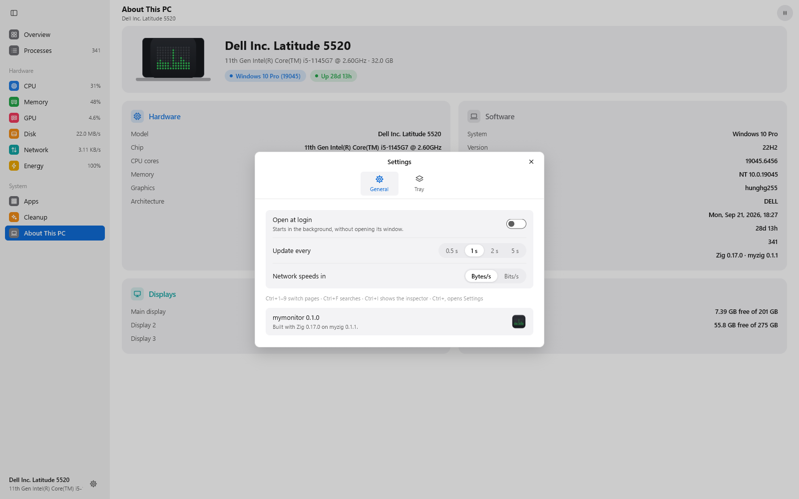
</p>
<p align="center">
  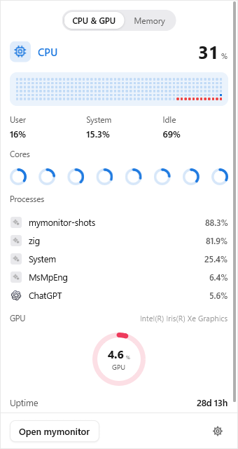
  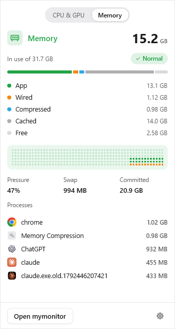
</p>

- **Overview:** a card for each part of the machine (CPU, memory, GPU, disk,
  network, battery), its figure now over a small dot graph; memory by kind
  as a donut, memory by app as tiles, CPU by app as bars.
- **Processes:** the full table, a program's processes together under a
  line of their sums (a chevron opens it), with each program's icon; All,
  Apps, My Processes and System; % CPU, % GPU, memory, threads, CPU time,
  PID and user; search. A click shows the process's details beside the
  table: Quit (it closes its windows) and Force Quit, its CPU and memory
  over time, CPU time, threads, GPU, private and virtual memory, disk,
  when it started, its path and its parent. A right-click offers Quit,
  Force Quit, Inspect, Copy PID, Copy Path, Copy Command, Show Only and
  Hide. Ctrl-click marks processes (Shift-click a run of them) to quit
  them together; you're asked first. At the bottom: how many show, whose
  owners Windows wouldn't say, and Run as Administrator to know them.
- **CPU:** the processor's load over a dot graph (system red under user
  blue), each core's load, the activity, and the apps using the most.
- **Memory:** app, wired, compressed and cached memory as figures, a bar
  and a graph; memory by kind; the pressure as a ring; the page file;
  memory by app; the apps using the most.
- **GPU:** its load, its 3D, copy and video engines, the memory it holds,
  and the apps using it most.
- **Disk:** reads and writes over time and since startup, each volume's
  free space (a click opens it), and the apps reading and writing the most.
- **Network:** downloads and uploads over time, each connected interface
  with its rates and addresses, and the others.
- **Energy:** the battery (charge, time left, flow, health against its
  design, capacity, the adapter), its level over time, the apps weighing
  on it, and where the power comes from.
- **Apps:** the installed apps, as Settings lists them (programs from
  their installers and the Microsoft Store's), with icon, version,
  publisher, size, install date and source; a green dot marks those
  running. A click shows its details: Open, Uninstall (after asking; its
  own uninstaller, or Settings for a Store app), its folder, the processes
  it runs, its package and path. A right-click offers Open, Uninstall,
  Show in File Explorer, Show in Processes, Copy Name and Copy Path.
- **Cleanup:** what can go (apps' caches, package managers' downloads,
  build caches, old Claude Code and Codex sessions, installers left in
  Downloads, logs, stale temporary files), scanned on a thread of its own;
  the drive as dots colored by what holds it; tick kinds and they move to
  the Recycle Bin, after asking.
- **About This PC:** the model, chip, memory, system, build, displays and
  storage.
- **Settings** (the gear): open at login, how often to sample (0.5 to 5
  seconds), network speeds in bytes or bits, and which parts the tray's
  panel shows.
- **The tray:** the icon in the taskbar's corner says the parts chosen in
  Settings in a line when the pointer rests on it ("CPU 18% · Memory
  16.6 GB / 31.7 GB"), kept current while the window is closed; a click
  shows a panel with a tab for each of them. Closing the window leaves the
  icon; its menu opens mymonitor again or quits.

Graphs span 1 minute to 1 hour, and you can pause them. Hover a graph: a card
over the column reads out its values and how long ago they were.

## What it reads

Activity Monitor gets its figures from a private system daemon (sysmond,
through libsysmon), which reads every process. mymonitor uses only public
interfaces:

- **Processes** (macOS): `proc_listallpids` lists them. `PROC_PIDTBSDSHORTINFO`
  gives each one's parent, user and short name, and `proc_pidpath` its
  program. A process inside an app bundle shows the app's name, as Activity
  Monitor does ("Google Chrome Helper (Renderer)").
- **CPU time and memory**: `proc_pid_rusage` gives these for the processes
  mymonitor may read (the user's own, which is most of them). Memory is the
  physical footprint, the figure Activity Monitor shows. For the system's
  processes, mymonitor asks `/bin/ps` (setuid, as `top` is) every third sample.
  It reads the answer as it arrives without waiting, and fills it in once
  it's there. ps reports resident memory for these, not the footprint.
- **The machine**: `host_processor_info` gives the CPU ticks per core.
  `host_statistics64` gives memory: app memory (anonymous, not purgeable),
  wired, compressed, and cached files (file-backed and purgeable).
- **Threads, idle wake ups and disk** (macOS): task info and rusage, for the
  processes mymonitor may read. Activity Monitor's daemon reads them for every
  process; mymonitor shows a dash for the rest.
- **Swap, memory pressure and the disks**: `vm.swapusage`,
  `kern.memorystatus_level`, and each block storage driver's statistics in
  IOKit.
- **The rest of the machine** (macOS):
  - **Each core's load:** `host_processor_info`, with fast and frugal cores
    told apart by `hw.perflevel*`.
  - **Load averages:** `getloadavg`.
  - **Every task and thread:** the default processor set's statistics.
  - **Thermal state:** NSProcessInfo.
  - **The GPU:** its accelerator's statistics in IOKit.
  - **The network:** each interface's 64-bit counters from its MIB data. The
    routing socket gives only 32 bits to anyone but root.
- **Linux**: `/proc/<pid>/stat`, `statm`, `status` and `io`, plus
  `/proc/stat` (each core too), `/proc/meminfo`, `/proc/diskstats`,
  `/proc/loadavg`, `/proc/uptime` and `/proc/net/dev`. There's no GPU page
  data there.
- **Windows**:
  - **Processes:** the kernel's list (`NtQuerySystemInformation`) gives every
    one's name, parent, threads, CPU time, private working set and disk
    bytes at once, protected processes too. Each program's path and owner
    are asked of the process once (an owner Windows won't say shows blank
    until mymonitor runs as Administrator); its icon comes from its .exe.
  - **The machine:** `GetSystemTimes` and each core's times; memory from
    `GlobalMemoryStatusEx` and the performance counters, compressed memory
    being what Memory Compression holds; the page files; each
    `PhysicalDriveN`'s counters; every interface from `GetIfTable2` and
    `GetAdaptersAddresses`; the volumes; the battery's IOCTLs.
  - **The GPU:** the GPU Engine and GPU Adapter Memory performance counters,
    as Task Manager reads them, each process's too.
  - Windows measures no app's watts: Energy shows the CPU and GPU an app
    keeps busy instead. Ending a process terminates it.

% CPU is a share of one core over the last interval (a second, by
default), so a busy process can pass 100%.

## Smooth and small

- **Sampling only when needed.** The view samples when it's due and asks
  for its next frame then (`c.frameIn`). With the window closed, a timer
  samples once an interval for the tray's line and draws nothing.
- **One frame a sample.** Figures and bars move to each sample's value at
  once; nothing animates between samples, so the window draws once a
  second. mymonitor itself takes a few percent of one core.
- **Graphs draw only what changes.** A graph follows the pointer only while
  you hover it (`c.wants_moves`), and redraws its readout once when the
  hovered column changes.
- **Icons a few at a time.** App icons are made once per app, at most six
  per frame, so the first screenful doesn't stall.
- **A virtualized table.** Only the rows in view are built (`ui.list`), so
  two thousand processes cost what a screenful does.

## Using it

- **Pages**: click the sidebar, or press Ctrl+1 to Ctrl+9. The button at
  the sidebar's top folds it to its symbols.
- **Pause**: the ⏸ button beside the range, or Ctrl+Shift+P.
- **Sort**: click a column; click it again to reverse the order.
- **Search**: type to filter by name, user or process ID (Ctrl+F).
- **Select**: click a row, or move with ↑ and ↓.
- **Details**: click a row; the panel button beside pause shows or hides
  them, Ctrl+I shows them.
- **Quit a process**: ⓧ, the details' Quit, or Ctrl+Alt+Q; you're asked
  first. Quit closes its windows; Force Quit ends it at once.
- **More**: right-click a process or an app.
- **Settings**: the gear at the sidebar's foot, or Ctrl+,.
- **Close**: Escape closes the open sheet or menu, then clears the selection.

## Files

```
src/main.zig          the window, the tray's icon and its panel
src/app.zig           state: sampling, the table's groups, search, selection, ending
src/model.zig         processes, the system, sorting, formatting
src/sample.zig        a sample: CPU percentages, history, names, users, rates
src/sample_windows.zig the kernel's process list, memory, disks, interfaces, GPU
src/win_gpu.zig       the GPU's engines and memory, from its performance counters
src/win_power.zig     the battery and the power plan
src/win_net.zig       the network's interfaces and their addresses
src/win_storage.zig   the volumes
src/win_machine.zig   the PC: model, chip, Windows, displays
src/win_icons.zig     a program's icon from its .exe, as PNG
src/win_apps.zig      the installed apps: the registry's and the Store's
src/cleanup_win.zig   what Cleanup finds, and the Recycle Bin
src/sample_mac.zig    libproc, Mach and sysctl
src/icons.zig         app icons for the table
src/ps.zig            /bin/ps for the processes mymonitor may not read (macOS)
src/sample_linux.zig  /proc
src/sample_none.zig   elsewhere
src/sample_sys_mac.zig   chip, cores, load, uptime, threads, thermal, network
src/sample_iokit_mac.zig the disks and the GPU, from IOKit
src/sample_sys_linux.zig the same from /proc
src/settings.zig      what is remembered between runs
src/view.zig          the window: sidebar, page, sheets, keys
src/view_side.zig     the sidebar
src/view_kit.zig      headers, cards, figures, bars, rings, tiles, the dot graph
src/glyphs.zig        the symbols, as SVG
src/view_overview.zig the overview
src/view_procs.zig    the processes page
src/view_table.zig    the process table
src/view_cpu.zig      CPU
src/view_memory.zig   memory
src/view_gpu.zig      GPU
src/view_io.zig       disk and network
src/view_energy.zig   energy
src/view_apps.zig     the installed apps
src/view_detail.zig   the details beside a table: a process's, an app's
src/view_cleanup.zig  cleanup
src/view_about.zig    About This PC
src/view_settings.zig Settings
src/view_tray.zig     the tray's panel
src/view_sheet.zig    the filter menu, the sheets that ask before quitting
src/shots.zig         pictures of every page with live figures (zig build shots)
src/tests_select.zig  marking, ending together
src/theme.zig         the colors, light and dark
src/tests.zig         tests
tools/make-icon.py    the icon (assets/, src/logo.svg, src/tray.png)
```

## License

mymonitor's own code is licensed under the [MIT License](LICENSE). The parts derived
from CodeGraff (the colors of the macOS app icon) keep CodeGraff's original **modified AGPLv3**, kept verbatim in
[`third_party/licenses`](third_party/licenses/CodeGraff-LICENSE.txt); see
[third-party notices](THIRD_PARTY_NOTICES.md).

## Credits

- **[myzig](https://github.com/hunghg255/myzig):** windows, layout, text, the
  GPU and CPU renderers, and the Tester that draws every page offscreen.
  myzig itself owes its design to
  [mygo](https://github.com/egoist/mygo) by
  [egoist](https://github.com/egoist), and to
  [GPUI](https://github.com/zed-industries/zed/tree/main/crates/gpui) by
  [Zed Industries](https://zed.dev).
- **egoist's activity monitor designs, and Pulse:** the sidebar of pages
  with live figures, graphs drawn as columns of dots, the cards, the tray's
  panel and the Cleanup page.
- **Apple's Activity Monitor:** what's worth showing, and how: memory split
  into app, wired, compressed and cached, % CPU as a share of one core, and
  the quit sheet. [rea](https://github.com/morluto/rea) helped show how
  Activity Monitor gets its figures.
- **[Harness](https://github.com/justrach/harness):** the Codegraff colors
  of the macOS app icon.

<p align="center"><sub>Built in Zig 0.17 on <a href="https://github.com/hunghg255/myzig">myzig</a> · <a href="LICENSE">MIT</a> · <a href="THIRD_PARTY_NOTICES.md">third-party notices</a></sub></p>
